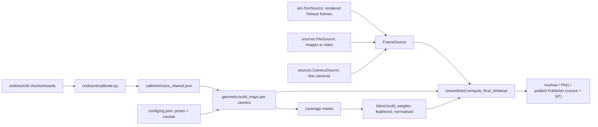

# BirdsEyeView Architecture

## 1. Purpose and status

BirdsEyeView builds a top-down ("bird's-eye") image of the area around an FRC robot from four fisheye USB cameras, one facing each cardinal direction (North/front, East/right, South/back, West/left). Each raw fisheye frame is remapped straight onto a robot-centred floor canvas, the four footprints are blended, and the result is streamed to the driver station via cscore (MJPEG) and NetworkTables.

The cameras deliberately do not cover everything. Regions that no camera sees stay pure black, so the final image shows lit "spotlight" regions (camera coverage) against a dark background (blind spots: the robot body and a ring around it, the far diagonal corners, and anything beyond a camera's range).

Status: the full pipeline runs end to end offline. Physical cameras are not available yet, so calibration and capture are replaced by:

- the existing shared intrinsics (`calib/intrinsics_shared.json`, reproduced from the checkerboard set `undistort/all`),
- a pose-based camera model (`config/rig.json`) instead of measured ground homographies,
- a synthetic fisheye simulator (`birdseye/sim.py`) that renders what each camera would see of a procedural floor with known markers.

Real intrinsics, poses and frames drop in through the same config files and the `FileSource`/`CameraSource` interfaces (see section 10).

To see the current output, run `.venv\Scripts\python production\streamlined.py --source sim --save out.png --headless` and open `out.png` (output images are git-ignored).

## 2. Pipeline



Everything left of `compute_final_birdseye` is computed once at start-up by `streamlined.Pipeline` (about 0.4 s). Per frame the cost is one `cv2.remap` per camera (raw 1280x720 fisheye to the 600x600 canvas, `CV_16SC2` maps) plus a weighted sum: about 28 ms per frame for four cameras on the development PC (about 34 FPS).

## 3. File map

Pipeline (maintained, tested):

| File | Role |
|---|---|
| `production/streamlined.py` | Entry point. `Pipeline` (per-rig maps and weights), `unwarp`, `transform`, `compute_final_birdseye`, `main()` CLI |
| `birdseye/calib.py` | `Intrinsics` (`K`, `D`, `dim`, `rms`, `source`), `load_intrinsics`, `save_intrinsics`, `Intrinsics.scaled_to` |
| `birdseye/rig.py` | `CanvasCfg`, `CameraCfg`, `Rig`, `load_rig`; documents the coordinate conventions |
| `birdseye/geometry.py` | `pose_to_extrinsics`, `canvas_to_floor`/`floor_to_canvas`, `project_floor_points`, `build_maps` (combined canvas to raw fisheye remap plus coverage), `homography_from_points`, `build_maps_from_homography` |
| `birdseye/blend.py` | `build_weights` (coverage feathered with `cv2.distanceTransform`, normalised), `blend` (renormalises around missing frames) |
| `birdseye/sim.py` | Procedural floor texture with `MARKERS`, inverse fisheye renderer `render_camera`, `SimSource`; `python -m birdseye.sim` writes `samples/sim/*.png` |
| `birdseye/sources.py` | `FrameSource` protocol, `FileSource` (per-camera images or videos), `CameraThread`/`CameraSource` (live capture, untested without hardware) |
| `birdseye/publish.py` | `Publisher`: cscore MJPEG server plus NT4 client (`server` or `team`), advertises under `/CameraPublisher/<name>` |
| `config/rig.json` | Canvas and camera poses (see section 5) |
| `calib/intrinsics_shared.json` | Shared fisheye intrinsics, written by `undistort/calibrate.py` |
| `samples/sim/{north,east,south,west}.png` | Simulated raw frames for `--source files` demos |
| `tests/` | pytest suite (section 4) |
| `pytest.ini`, `requirements.txt`, `requirements-dev.txt` | Test config (registers the `slow` marker) and dependencies |

Calibration (maintained):

| File | Role |
|---|---|
| `undistort/calibrate.py` | `calibrate(image_glob, verbose) -> (K, D, DIM, rms, n_ok, n_images)`; CLI saves JSON. 7x10 inner-corner checkerboard |
| `undistort/undistortlib.py` | Old undistort helper: loads `K`/`D` from the JSON (hardcoded fallback), import-time maps, `undistort`, `crop`, `resize`. Kept for `main.py` |
| `undistort/all`, `try2`, `try3`, `try4`, `charuco`, `example` | Calibration images (`all` is the real set) |

Legacy (kept for reference only, not maintained, not fixed; may not run):

| File | Was |
|---|---|
| `legacy/warptest.py` | First homography/stitch experiment (placeholder points, permutation rotation) |
| `legacy/warptest2.py` | Rewrite with `CameraThread`, `precompute_remap`, `--calibrate` point picker; ideas carried into `birdseye.sources` and `geometry` |
| `legacy/canvastest_undistort.py` | Was `undistort/canvastest.py`: `warptest.py` plus canvas placement |
| `legacy/canvastest_production.py` | Was `production/canvastest.py`: copy of the above with placeholder points |
| `legacy/warppublish.py` | Was `nt/warppublish.py`: published one unstitched warped view; replaced by `birdseye.publish` |

Utilities and unrelated:

| File | Role |
|---|---|
| `main.py` | Live undistort preview of one camera (uses `undistortlib`) |
| `accessRobotTests/network.py`, `dsnt.py` | robotpy cscore/NT examples and connectivity check |
| `scanUtils/scan.py`, `scanUtils/scanPreview.py` | Probe camera indices; list DirectShow device names (for pinning N/E/S/W devices) |
| `stretch.py` | One-off image resize |
| `nt/soundtest.py`, `nt/soundplaying.py`, `media/` | FRC match-shift timer sound player; not vision |

## 4. How to run

Environment (Windows, PowerShell; Python 3.12):

```powershell
py -3.12 -m venv .venv
.venv\Scripts\python -m pip install -r requirements-dev.txt
```

CLI (works from any directory; the script puts the repo root on `sys.path`):

```powershell
# One simulated frame, saved, no window
.venv\Scripts\python production\streamlined.py --source sim --save out.png --headless

# Per-camera images or videos named <camera>.png / <camera>.mp4 in a directory, live window
.venv\Scripts\python production\streamlined.py --source files --dir samples\sim --show

# Stream to a local NT server (simulator) or to the robot, 100 frames
.venv\Scripts\python production\streamlined.py --source sim --publish --server 127.0.0.1 --headless --frames 100
.venv\Scripts\python production\streamlined.py --source files --publish --team 3006 --port 1181 --headless
```

| Flag | Meaning |
|---|---|
| `--rig PATH` | Rig JSON (default `config/rig.json`) |
| `--source sim\|files`, `--dir DIR` | Frame source; `--dir` defaults to `samples/sim` |
| `--show` | `cv2.imshow` window (Esc or q quits); ignored with `--headless` |
| `--save PNG` | Write the last canvas |
| `--publish`, `--server ADDR` or `--team N`, `--port P` | MJPEG stream (port 1180-1190, default first free from 1181) and NT client |
| `--frames N` | Stop after N frames. Default: 1 frame, unless `--show` or `--publish`, which run until stopped |
| `--feather PX` | Seam feather width (default 40 px) |

FPS and per-frame compute time are logged about once a second. The first `--source sim` frame takes a few seconds because the simulator renders and caches the four views.

Other entry points:

```powershell
.venv\Scripts\python -m birdseye.sim            # regenerate samples/sim/*.png
.venv\Scripts\python undistort\calibrate.py     # recalibrate, writes calib/intrinsics_shared.json
```

Tests:

```powershell
.venv\Scripts\python -m pytest                  # everything, about 20 s
.venv\Scripts\python -m pytest -m "not slow"    # skip the calibration reproduction (about 13 s)
```

| Test file | Checks |
|---|---|
| `test_calibration.py` | JSON round trip, `scaled_to`; (slow) recalibrating `undistort/all` reproduces the stored `K`/`D` (`fx` within 1e-6, 145/147 images) |
| `test_geometry.py` | Extrinsics orthonormal with correct centre and axis; canvas/floor round trip; every simulated marker lands within 2 px of its expected canvas pixel (stitched and per camera); floor lines stay straight (residual under 1.5 px, position within 2 px), including across overlaps; the homography path reproduces the pose maps |
| `test_spotlights.py` | Robot centre and diagonal corners have coverage 0 and output exactly 0; all uncovered pixels are 0; weights sum to 1 where covered; single-coverage brightness matches the floor texture (mean ratio within 1 %); overlaps agree between neighbours |
| `test_robustness.py` | Behind-camera and `theta > theta_max` rejection; coverage respects `max_range_m`; missing frames renormalise; all-missing gives black; low-resolution frames are resized; `unwarp`; `FileSource` with missing files |
| `test_publish.py` | In-process NT4 server on a non-default port: `Publisher` connects, `put` accepts canvas-size frames and rejects wrong sizes/dtypes, the stream is advertised under `/CameraPublisher/BirdsEye/streams`. Skipped if `ntcore`/`cscore` are missing |
| `test_cli.py` | `streamlined.py --source sim --save ... --headless` exits 0 from another directory; `main()` with `--source files` matches the in-process result |

## 5. Coordinate conventions

Defined in `birdseye/rig.py` and used everywhere:

- Robot frame (metres): origin at the robot centre on the floor; +x East (robot right), +y North (robot front), +z up. The floor is z = 0.
- Camera pose (robot frame): `position_m` (x, y) and `height_m` of the lens; `yaw_deg` heading of the optical axis measured clockwise from North seen from above (N 0, E 90, S 180, W 270); `tilt_deg` downward pitch below horizontal; no roll.
- Camera frame: OpenCV convention, +x image right, +y image down, +z along the optical axis; `X_cam = R @ X_world + t` (`geometry.pose_to_extrinsics`).
- Canvas (pixels): North up, East right. Pixel (u, v) is the floor point `x = (u - cx) / px_per_m`, `y = (cy - v) / px_per_m`, with `center_px` defaulting to `((W - 1) / 2, (H - 1) / 2)`.
- Intrinsics: OpenCV fisheye (Kannala-Brandt), \(r = f\,\theta(1 + k_1\theta^2 + k_2\theta^4 + k_3\theta^6 + k_4\theta^8)\). `DIM` is (width, height); `Intrinsics.scaled_to` rescales `K` for other capture sizes (`D` is resolution independent).

Default rig (`config/rig.json`): 600x600 canvas at 100 px/m (6 x 6 m), robot 0.8 x 0.8 m, cameras centred on each edge at 0.30 m height, tilted 35 degrees down, yaw 0/90/180/270, `theta_max_deg` 68, `max_range_m` 2.5, all sharing `calib/intrinsics_shared.json`. Each entry in `cameras` is merged over `defaults`, so per-camera overrides (intrinsics file, `frame_size`, pose) go in the camera entry.

## 6. How each stage works

### Calibration and intrinsics

- `calibrate.py` detects 7x10 corners (adaptive threshold, subpixel refinement) and runs `cv2.fisheye.calibrate` with `RECOMPUTE_EXTRINSIC | CHECK_COND | FIX_SKEW` (flags looked up as `cv2.CALIB_*` with a `cv2.fisheye.CALIB_*` fallback, so OpenCV 4 and 5 both work). On `undistort/all` it finds 145 of 147 boards, RMS 1.088 px, and reproduces the previously hardcoded `K`/`D` exactly.
- `K`: fx 700.4, fy 702.8, cx 646.7, cy 312.9 (principal point about 47 px above centre), `DIM = (1280, 720)`.
- The distortion polynomial stops being monotonic at about 70 degrees off-axis, so the outermost raw corners cannot be inverted. The pipeline clamps coverage at `theta_max_deg = 68`.

### Combined remap (`geometry.build_maps`)

For each canvas pixel: canvas to floor (x, y, 0), floor to camera frame with the pose, reject if behind the lens (z <= 0), beyond `theta_max_deg`, beyond `max_range_m` (horizontal distance from the lens) or outside the raw image, otherwise project with the fisheye model to a raw pixel. Rejected pixels map to (-1, -1), which `cv2.remap` with `BORDER_CONSTANT` renders black; the valid set is the camera's coverage mask. There is no intermediate undistorted image, so there is one interpolation and the full field of view is used (the old `Knew = K` undistort kept only about 85 x 54 degrees).

`homography_from_points` is the alternative for measured floor marks: it undistorts the raw image points, fits `H` to their canvas positions, and `build_maps_from_homography` turns it into the same kind of maps (rejecting points behind the lens). A test checks it reproduces the pose maps to under 0.5 px.

### Blending (`blend`)

Each coverage mask is feathered inward with `cv2.distanceTransform` (ramp over `feather_px`), then the weights are normalised only where their sum is above zero. Singly covered pixels get weight exactly 1 (full brightness), overlaps cross-fade, uncovered pixels stay exactly 0. Missing frames (`None`) are dropped and the remaining weights renormalised per pixel, so a neighbour fills the shared overlap and the missing camera's exclusive area goes black.

### Simulator (`sim`)

Works backwards from the raw image: each raw pixel is unprojected (Newton inversion of the distortion polynomial up to its monotonic limit) to a ray, intersected with the floor, and the procedural texture is sampled with trilinear mipmapping. Rays that miss the floor get a sky colour. The floor has a 0.25 m grid (1 m lines heavier, axes white), one colour per quadrant, the robot footprint and 12 magenta markers at known positions (`sim.MARKERS`). The renderer only shares `pose_to_extrinsics` with `build_maps`, so the geometry tests are not circular; markers land within about 0.15 px.

### Sources and publishing

- `FileSource(dir, cameras)` loads `<name>.<image ext>` (returned every read) or `<name>.<video ext>` (advanced per read, looped); missing cameras yield `None`.
- `CameraSource(devices, cameras, resolution, fps, fourcc="MJPG")` runs one `CameraThread` per camera that keeps only the latest frame with a `time.monotonic()` timestamp, sets FOURCC before resolution, uses `CAP_DSHOW`/`CAP_V4L2` for integer devices and `CAP_ANY` for paths/URLs, drops frames older than `stale_s`, and joins its thread on release.
- `Publisher(width, height, name, server | team, port, nt_port)` creates the MJPEG server (port 1180-1190) and a `CvSource` at the canvas size, starts an NT4 client on the default instance (so CameraServer advertises the stream), and checks `isConnected()` instead of sleeping.

## 7. Canvas layout and spotlights

With the default rig, 40 % of the canvas is uncovered, 56 % is seen by exactly one camera and 3.5 % by two:

- The robot body and a ring around it are blind (each camera's lower frame edge), as are the far diagonal corners (beyond `max_range_m` and outside the side cameras' FOV). Thin black spikes run diagonally out from the robot corners where adjacent wedges have not yet met.
- Adjacent cameras overlap along the diagonals around 1.2 m from the centre (the horizontal FOV with the full fisheye is wider than 90 degrees). This is accepted: the blend cross-fades there, and tests check the overlaps agree with each other and with the floor.
- Uncovered pixels are exactly 0 and covered pixels are full brightness (no dimming), unlike the old blends that averaged black pixels from cameras that could not see the point.

Shape the spotlights through `config/rig.json`: `max_range_m` trims the outer edge, `tilt_deg`/`height_m` move the near edge and the overlap, `theta_max_deg` limits the angular extent.

## 8. Environment

- Python 3.12 in `.venv` (`requirements.txt`, plus `pytest` in `requirements-dev.txt`). Verified with OpenCV 4.14, numpy, pyntcore/robotpy-cscore 2026.2.2.
- OpenCV is pinned `>=4.5,<5`, but the calibration code also handles the OpenCV 5 flag names.
- Keep pyntcore/robotpy-cscore on the same WPILib year as the robot.
- `.venv`, caches and output images (`out*.png`, `outputs/`) are git-ignored.

## 9. Bug status

Bugs found in the original code, with their current status. "Legacy" means the code moved to `legacy/` and was replaced rather than fixed.

| # | Original location | Problem | Status |
|---|---|---|---|
| 1 | `undistort/calibrate.py` | `cv2.fisheye.CALIB_*` missing in OpenCV 5 | Fixed (flag lookup with fallback) |
| 2 | `undistort/calibrate.py` | CWD-relative glob, `NameError` when no images | Fixed (script-relative default, explicit error) |
| 3 | `undistort/calibrate.py` | RMS discarded, results pasted by hand | Fixed (RMS printed, JSON saved via `birdseye.calib`) |
| 4 | `undistort/undistortlib.py` | Maps fixed to `DIM` regardless of frame size | Open in `undistortlib` (only used by `main.py`); pipeline handles sizes via `frame_size`/`scaled_to` and `transform` resizing; `streamlined.unwarp` scales to the frame |
| 5 | `undistort/undistortlib.py` | `crop` takes the top-left corner | Open (only used by `main.py` and legacy) |
| 6 | intrinsics | `D` non-monotonic past about 70 degrees | Handled (`theta_max_deg = 68` coverage clamp; simulator respects the monotonic limit) |
| 7 | `warptest.py` and copies | Placeholder points outside the frame, shared by all cameras | Legacy (replaced by pose-based maps and `homography_from_points`) |
| 8 | `warptest.py` and copies | Rotation pivots around (300, 400) | Legacy (rotation comes from camera yaw) |
| 9 | `warptest2.py` | Identical `src`, translation-only `dst` | Legacy |
| 10 | `warptest2.py` | 3 sources for 4 homographies, `zip` drops one | Legacy (`compute_final_birdseye` checks the frame count) |
| 11 | `warptest2.py` | Coverage-unaware masks, every camera weighted 1/4 | Fixed in `birdseye.blend` |
| 12 | `warptest2.py` | No `w <= 0` guard | Fixed (`build_maps` rejects z <= 0; homography maps reject w <= 0) |
| 13 | `warptest2.py` | `put(None)` hang, no join, `CAP_DSHOW` for files | Fixed in `birdseye.sources.CameraThread` |
| 14 | `warptest2.py` | Click calibration on wrong resolution, saves nothing | Legacy; `homography_from_points` is the fitting half, a click tool is still to be written (section 10) |
| 15 | `warptest2.py` | Sequential reads, no timestamps | Fixed as far as software allows (threaded capture, timestamps, stale-frame drop); no hardware sync |
| 16 | `warptest.py` and copies | Per-pixel Python mask loops, unbounded mask cache | Legacy |
| 17 | both `canvastest.py` | `warp_to_birdseye` defined twice | Legacy |
| 18 | both `canvastest.py` | `fx2 = fy1 + ...`, unclipped placement, dark floor treated as holes | Legacy |
| 19 | `nt/warppublish.py` | Hardwired `127.0.0.1`, sleep instead of `isConnected()` | Fixed in `birdseye.publish` (`--server`/`--team`, `wait_connected`) |
| 20 | `nt/warppublish.py` | Declares 640x480, sends 600x600; one camera only | Fixed (stream declared at canvas size, stitched canvas published) |
| 21 | `nt/warppublish.py` | Discarded per-frame work | Legacy |
| 22 | `nt/warppublish.py` | Windows-only capture, `imshow` not headless | Fixed (`--headless`; `CameraSource` picks the backend per platform) |
| 23 | `warptest.py`, `main.py`, `production/canvastest.py` | `from undistortlib import ...` fails from their directories | Fixed for new code (`birdseye` package, entry points add the repo root to `sys.path`); still open for `main.py` (run it from `undistort/` or with it on `PYTHONPATH`) and legacy |
| 24 | all scripts | No `__main__` guard | Fixed for `calibrate.py`, `streamlined.py`, `birdseye.sim`; open for legacy and the utility scripts |
| 25 | `production/streamlined.py` | Parameter named `np` | Fixed |

New in this round: `sim.FloorTexture.sample` failed for more than 32767 points (the `cv2.remap` map size limit); it now folds the points into rows.

## 10. Next steps when cameras are available

1. Per-camera intrinsics. Capture 30 to 50 checkerboard views per camera at the production resolution, covering the image corners. Run `undistort\calibrate.py --images "path\to\north\*.jpg" --out calib\intrinsics_north.json` per camera and set `"intrinsics"` in that camera's entry in `config/rig.json`. If the lenses turn out identical (reprojection error against the shared model under about 1.5 px), keep the shared file. If capture runs at a different size than the calibration, set `"frame_size": [w, h]` so `K` is rescaled.
2. Real poses. Measure each lens position (x, y from the robot centre), height, yaw and downward tilt and enter them in `config/rig.json`. Verify by laying tape marks at known robot-frame positions and checking where they land on the canvas (the marker and straight-line tests show the method). Small tilt/yaw errors move far points the most, so tune those first.
3. Homography fallback. If the pose model cannot match (camera roll, lens not centred), collect at least 4 (better 8 or more) floor marks per camera, click them in a raw frame at the production resolution, and fit with `geometry.homography_from_points`; `build_maps_from_homography` gives drop-in maps. This needs a small click tool (salvage the UI from `legacy/warptest2.py`) and a per-camera homography field in the rig JSON that `streamlined.Pipeline` uses instead of `build_maps`.
4. Device mapping for `CameraSource`. Pin each direction to a physical camera by device name or path, not USB index: `scanUtils/scanPreview.py` lists DirectShow names on Windows; on a Linux coprocessor use `/dev/v4l/by-path/...`. Then `CameraSource({"north": ..., "east": ..., "south": ..., "west": ...}, rig.cameras, resolution=(1280, 720), fourcc="MJPG")`. Add a `--source camera` option (with a device map in the rig JSON or on the command line) to `streamlined.py`; it currently offers `sim` and `files` only. Check that four MJPG streams fit the USB bandwidth.
5. Recorded regression data. Record a short clip per camera into a directory as `<name>.mp4` and run `--source files --dir ...`; add an offline test on those frames (seam alignment on tape lines, black spotlights, FPS budget).
6. Spotlight tuning. Adjust `max_range_m`, `tilt_deg`, `theta_max_deg` and `--feather` on real footage; consider a robot outline overlay in the blind centre.
