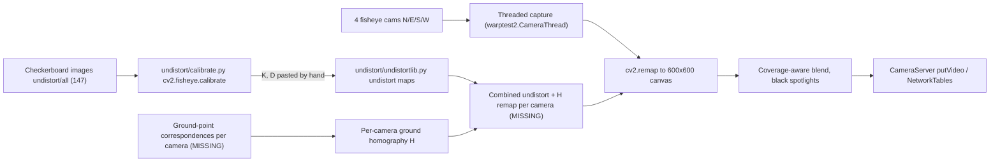

# BirdsEyeView Architecture

## 1. Purpose and context

BirdsEyeView builds a top-down ("bird's-eye") image of the area around an FRC robot from four fisheye USB cameras, one facing each cardinal direction (North/front, East/right, South/back, West/left). Each camera is unwarped (fisheye undistortion), projected onto the ground plane with a homography, and composited onto a single canvas centred on the robot. The result is meant to be streamed to the driver station via CameraServer/NetworkTables.

The cameras deliberately do not cover everything. Regions that no camera sees stay black, so the final image shows lit "spotlight" regions (camera coverage) against a dark background (blind spots: the robot body, the diagonal gaps between adjacent cameras, and anything beyond a camera's range).

Status: unfinished. Stage 1 (intrinsic calibration and undistortion) works. Stages 2 to 4 exist only as experiments with placeholder geometry. The intended production entry point, `production/streamlined.py`, is three empty stubs.

## 2. Pipeline



Today the code runs two disconnected halves: `undistortlib` (stage 1, correct) and the warp/stitch experiments (stages 2 to 3), which mostly skip undistortion and use made-up points. `nt/warppublish.py` (stage 4) publishes one raw, unstitched warped view.

## 3. File map

Core (stage 1, working):

| File | Role |
|---|---|
| `undistort/calibrate.py` | `cv2.fisheye.calibrate` on a 7x10 inner-corner checkerboard from `undistort/all/*.jpg`; prints `DIM`, `K`, `D` |
| `undistort/undistortlib.py` | Hardcoded `K`/`D` (plus 3 commented older sets), import-time `map1`/`map2`, `undistort`, `crop`, `resize` |
| `undistort/all`, `try2`, `try3`, `try4`, `charuco`, `example` | Calibration images (`all` is the real set; `charuco` and `try3`/`example` are unused) |

Experiments (stages 2 and 3, placeholder geometry):

| File | Role |
|---|---|
| `warptest.py` | Base version: `compute_homography`, `warpPerspective` to 600x600, 90/180/270 point-permutation rotations, per-pixel weight masks, `stitch_views` (commented out) |
| `undistort/canvastest.py` | `warptest.py` plus `create_canvas`, `place_frame`, `place_frame_masked`, offsets, 1920x1080 canvas |
| `production/canvastest.py` | Copy of the above plus unused named-point placeholders (unfinished cleanup) |
| `warptest2.py` | Independent rewrite and the cleanest architecture: `CameraThread`, `precompute_remap`, vectorised masks, `stitch`, `--calibrate` point picker. No undistort, no rotation, 3 sources |
| `production/streamlined.py` | Target entry point; empty stubs `transform`, `unwarp`, `compute_final_birdseye` |

Robot integration (stage 4):

| File | Role |
|---|---|
| `nt/warppublish.py` | `warptest.py` minus undistort, plus NT client and `CameraServer.putVideo`; publishes `warped[0]` |
| `accessRobotTests/network.py` | Canonical robotpy pattern: cscore capture, `getVideo` sink, `putVideo` output, sizes match |
| `accessRobotTests/dsnt.py` | NT connectivity check (reads `SmartDashboard/random`) |

Utilities and unrelated:

| File | Role |
|---|---|
| `main.py` | Live undistort preview |
| `scanUtils/scan.py`, `scanUtils/scanPreview.py` | Probe camera indices; list DirectShow device names (useful for pinning N/E/S/W indices) |
| `stretch.py` | One-off image resize |
| `nt/soundtest.py`, `nt/soundplaying.py`, `media/` | FRC match-shift timer sound player; not vision |

## 4. How each stage works

### Stage 1: calibration and undistortion

- Model: OpenCV fisheye (Kannala-Brandt equidistant), \(r = f\,\theta(1 + k_1\theta^2 + k_2\theta^4 + k_3\theta^6 + k_4\theta^8)\).
- `calibrate.py` detects corners (adaptive threshold, subpixel refinement), calibrates with `RECOMPUTE_EXTRINSIC | CHECK_COND | FIX_SKEW`, prints the result. Re-running it on `undistort/all` with OpenCV 4.x reproduces the hardcoded `K`/`D` exactly (145 of 147 images detected, RMS 1.088 px).
- `K`: fx 700.4, fy 702.8, cx 646.7, cy 312.9 (principal point about 47 px above centre). `DIM = (1280, 720)`.
- `undistortlib.py:16` builds the remap with `Knew = K`. Output is rectilinear 1280x720 but only about 85 x 54 degrees of the raw roughly 114 degree horizontal FOV survive; the image edges are cropped away. `balance=1` would keep about 114 x 81 degrees with curved black borders.
- The active `D` stops being monotonic at theta of about 70 degrees, so the outermost raw corners cannot be inverted. Harmless with `Knew = K`, but any wider projection must clamp coverage below about 68 degrees (or use the older "alt A" set at `undistortlib.py:9-11`, which stays monotonic to 100 degrees).
- All four cameras currently share this one `K`/`D`.

### Stage 2: ground-plane homography

- A homography `H` maps 4+ ground points in a camera image to canvas pixels (`cv2.findHomography`, RANSAC). Valid only if (a) the input image is undistorted (rectilinear) and (b) the points really lie on the floor.
- Old line (`warptest.py`, both `canvastest.py`, `warppublish.py`): `front_src` at `warptest.py:17` has points at y=600, outside every frame these scripts use (640x360 after `resize(undistort(f), 0.5)`, or 640x480 raw). The other cameras reuse the front points (`warptest.py:35-37`). Rotation is done by permuting the destination square (`warptest.py:19`), which rotates about the square's centre (300, 400), not the canvas centre (300, 300).
- `warptest2.py`: source points fit 640x480 but are identical for all four cameras and the destination squares are only translated (`warptest2.py:58-79`), so every view faces "up". `precompute_remap` (`:137-157`) inverts `H` once and replaces per-frame `warpPerspective` with `cv2.remap`; this is the right idea.
- No ground-plane calibration data (images, tape measurements, or point lists) exists anywhere in the repo.

### Stage 3: stitching

- `warptest.py`/`canvastest.py`: `stitch_views` with a centre-weighted mask built in per-pixel Python loops; stitching is commented out. `canvastest.py` instead pastes one view onto a 1920x1080 canvas with `place_frame_masked` (black pixels treated as transparent).
- `warptest2.py`: `precompute_all` builds one remap and one mask per camera, normalises masks by their sum, and `stitch` accumulates `remap(frame) * mask`. Because the masks are identical and ignore coverage, each camera contributes exactly 1/4 everywhere.

### Stage 4: robot publishing

- `nt/warppublish.py:86-101`: `startClient4("my-dashboard")`, `setServer("127.0.0.1")` (local simulator only), `time.sleep(1)` instead of a connection check, `putVideo("Processed", 640, 480)` while frames are 600x600, then `putFrame(warped[0])` (`:165`): one camera, not undistorted, placeholder `H`, not stitched. Uses `CAP_DSHOW` and `cv2.imshow`, so Windows-only and not headless.
- `accessRobotTests/network.py` is the pattern to copy (cscore capture is cross-platform, sizes match). `nt/soundtest.py:46` suggests team 3006 for `setServerTeam`.

## 5. Canvas layout and spotlights

Intended layout (600x600, robot at the centre, North up):

```
             far North (wedge)
        .   [   NORTH view   ]   .
   [ WEST ]  +--------------+  [ EAST ]
   [ view ]  |  robot body  |  [ view ]
   [      ]  |  (blind)     |  [      ]
        .   [   SOUTH view   ]   .
             far South (wedge)
  "." = diagonal gaps between adjacent cameras (blind)
```

Where blind spots come from:

- Each camera sees a bounded wedge of floor: nothing closer than the bottom edge of its frame (the robot body and a ring around it), nothing outside its horizontal FOV, and in practice nothing beyond a useful range. With `Knew = K` the horizontal FOV is about 85 degrees, less than the 90 degrees per quadrant, so the diagonals between adjacent cameras are never seen. These uncovered areas are the spotlight-style dark regions.
- `cv2.warpPerspective`/`cv2.remap` write 0 (black) wherever a camera has no source pixel. The current blends do not know where each camera has coverage, so they average those black pixels in: uncovered regions are black (correct), but singly covered regions are dimmed (to 25% in `warptest2.py`) and overlaps come out darker. The `1e-6` floor (`warptest.py:77`, `warptest2.py:190`) is only a divide-by-zero guard; it is not the source of the blind spots.
- With the current placeholder homographies the footprints are unbounded fans wider than the canvas, so the corners overlap instead of staying dark. Measured on `warptest.py` geometry: 39% blind (a square centred at (300, 400)), 50% single coverage, 11% double. `warptest2.py`: all fans open upward, 20% blind along the bottom.

Fix: coverage-aware weights. For each camera compute a coverage mask (remap source in bounds, homogeneous `w > 0`, ray angle below the monotonic limit, optional max range), feather it with `cv2.distanceTransform` for smooth seams, multiply, and normalise only where the sum is greater than 0. Uncovered pixels stay black; covered pixels keep full brightness.

## 6. Environment

- Python: original caches are CPython 3.11; 3.12 also works. No requirements file exists and the system Python on the dev machine has none of the packages installed.
- OpenCV 5.0 breaks `undistort/calibrate.py:8` (`cv2.fisheye.CALIB_*` constants removed). Pin `<5` or switch to `cv2.CALIB_*`. Verified working on OpenCV 4.14.
- Scripts import `from undistortlib import ...`, which only resolves when run from `undistort/` (or with it on `PYTHONPATH`). `.vscode/settings.json` `extraPaths` affects the editor only.

Proposed requirements (not yet committed as a file):

```text
# Core vision: fisheye calibration, undistort, homography/stitching
opencv-python>=4.5,<5     # calibrate.py uses cv2.fisheye.CALIB_* flags removed in OpenCV 5.0
numpy>=1.24

# Robot integration: nt/warppublish.py, accessRobotTests/
# Keep on the same WPILib year as the robot (2026.x resolved on Python 3.12)
pyntcore>=2026,<2027
robotpy-cscore>=2026,<2027

# Camera enumeration: scanUtils/scanPreview.py (DirectShow)
pygrabber; sys_platform == "win32"

# Match-timer sound scripts: nt/sound*.py (not part of the vision pipeline; could move to requirements-sound.txt)
pygame
playsound==1.2.2          # 1.3.0 is known to fail on Windows
```

`opencv-contrib-python` is not needed (no ArUco/ChArUco code).

## 7. Known bugs

Calibration and undistortion:

1. `undistort/calibrate.py:8` - `cv2.fisheye.CALIB_*` missing in OpenCV 5.
2. `undistort/calibrate.py:14` - CWD-relative glob; run from `undistort/` it finds 0 images and then fails with `NameError` on `gray`.
3. `undistort/calibrate.py:36` - RMS discarded; results are not saved, `K`/`D` must be pasted by hand.
4. `undistort/undistortlib.py:16,22` - maps built for fixed `DIM=(1280,720)`; `h, w` computed but unused, so other frame sizes are silently mis-mapped.
5. `undistort/undistortlib.py:41-42` - `crop` takes the top-left corner, not the centre.
6. `undistort/undistortlib.py:8` - `D` non-monotonic past about 70 degrees (matters only for wider projections).

Homography and stitching:

7. `warptest.py:17,35-37` (same in `nt/warppublish.py:19,37-39`, `undistort/canvastest.py:53,74-76`, `production/canvastest.py:61,82-84`) - placeholder points, y=600 outside the frame, all cameras reuse the front points.
8. `warptest.py:19-23` (and copies) - rotation pivots around (300, 400), not the canvas centre; `undistort/canvastest.py:56-59` adds a -300 y-shift so the views no longer share a pivot.
9. `warptest2.py:58-79` - identical `src` for all cameras and translation-only `dst`; no rotation.
10. `warptest2.py:46` - `CAMERA_SOURCES` has 3 entries for 4 homographies; `zip` at `:211` silently drops RIGHT.
11. `warptest2.py:160-170,186-191` - masks identical and coverage-unaware; every camera weighted 1/4.
12. `warptest2.py:151-152` - no guard for `w <= 0` in the perspective divide.
13. `warptest2.py:102` - `put(None)` can block forever on a full queue; `:119-121` `release()` does not join the thread; `:89` `CAP_DSHOW` cannot open files or URLs despite the docstring.
14. `warptest2.py:230,264` - `run_calibration` clicks on native-resolution raw frames while `stitch` applies `H` to resized 640x480 frames; it collects no `dst` points and saves nothing.
15. `warptest2.py:303` - cameras read one after another with no timestamps; no synchronisation.
16. `warptest.py:51-63` (and copies) - `create_weight_mask` uses per-pixel Python loops; the `numMasks < 4` cache builds 16 masks over the first 4 frames and never checks shape.
17. `undistort/canvastest.py:84-88`, `production/canvastest.py:92-96` - `warp_to_birdseye` defined twice; the 3-argument version shadows the 2-argument one.
18. `undistort/canvastest.py:21`, `production/canvastest.py:21` - `fx2 = fy1 + ...` should be `fx1 + ...`; `place_frame` (`:9-12`) does not clip; `place_frame_masked` (`:30`) turns genuinely dark floor into holes.

Robot publishing:

19. `nt/warppublish.py:92` - hardwired to `127.0.0.1`; `:96` sleep instead of `isConnected()`.
20. `nt/warppublish.py:101,165` - declares 640x480, sends 600x600; publishes only `warped[0]`.
21. `nt/warppublish.py:141-142` - computes `warped_rotate` every frame and discards it.
22. `nt/warppublish.py:108,160-163` - `CAP_DSHOW` and `cv2.imshow` make it Windows-only and not headless.

Structure:

23. `warptest.py:3`, `main.py:2`, `production/canvastest.py:3` - `from undistortlib import ...` fails at runtime from their directories.
24. All scripts call `main()` at module level without an `if __name__ == "__main__"` guard (for example `warptest2.py:325`, `nt/warppublish.py:182`).
25. `production/streamlined.py:6` - `unwarp(img, np)` names a parameter `np`, shadowing the usual numpy alias.

## 8. Gap analysis

### Stub-to-code mapping for `production/streamlined.py`

| Stub | Intended role | Existing code to reuse | What is missing |
|---|---|---|---|
| `unwarp(img, np)` | Fisheye undistortion | `undistort/undistortlib.py:16,21-28` (`initUndistortRectifyMap` + `remap`) | Per-camera `K`/`D` loaded from files, not hardcoded; `DIM` tied to actual capture size; ideally folded into the combined map so it is never run as a separate pass |
| `transform(img, map)` | Apply a precomputed per-camera map (undistort + ground warp) | `warptest2.py:137-157` (`precompute_remap`) and the `cv2.remap` call at `:215-218` | The map must chain fisheye distortion (see below); `w <= 0` guard; a coverage mask returned alongside the map |
| `compute_final_birdseye(src1..src4)` | Blend 4 warped views onto the robot-centred canvas | `warptest2.py:173-221` (`precompute_all`, `stitch`); robot-frame layout idea from the `dst` squares in `warptest2.py:58-79` | Real per-camera homographies; coverage-aware feathered weights; handling of missing frames (renormalise); robot overlay for the centre |

### Missing pieces

1. Per-camera intrinsics. All cameras use one `K`/`D` from one camera. Either calibrate each camera (about 30 to 50 checkerboard views each, covering the corners better than the current set) or verify the lenses are identical by checking each camera's reprojection error against the shared model (under about 1.5 px is acceptable). Persist results to files (for example `calib/cam_N.npz` or YAML), keyed by the physical camera.
2. Extrinsic / ground-point calibration per camera. No bird's-eye training data exists. Required: for each mounted camera, a set of floor points with known robot-frame coordinates (tape marks or a floor checkerboard measured from the robot centre). Detect or click them in the raw frame, undistort the points with `cv2.fisheye.undistortPoints`, and fit `H` against canvas coordinates computed as `center + scale * (x_robot, y_robot)`. This replaces the permutation-rotation trick: rotation, offset and scale all come from the measured robot-frame coordinates. Alternative: `cv2.solvePnP` on undistorted points to recover each camera's pose and derive `H = Knew [r1 r2 t]`.
3. Combined undistort + homography remap. For every canvas pixel: apply `H^-1` to get an undistorted pixel, normalise with `Knew^-1` (reject `w <= 0`), then map to a raw fisheye pixel with `cv2.fisheye.distortPoints(pts, K, D)`. Store as `CV_16SC2` maps. One `cv2.remap` per camera per frame then goes straight from raw frame to canvas, avoids double interpolation, and recovers the FOV that `Knew = K` throws away. Clamp coverage below the about 70 degree monotonic limit of `D`.
4. Synchronised 4-camera capture. Extend `CameraThread`: set resolution and MJPG FOURCC explicitly (4 x 1280x720 YUYV will not fit typical USB bandwidth), keep only the latest frame with a timestamp, fix the `put(None)` hang and join on release, and use a cross-platform backend (cscore `UsbCamera`/`CvSink` or `CAP_V4L2` on a Linux coprocessor). Pin camera identity to direction by device path or name (see `scanUtils/scanPreview.py`), not USB index. Drop or flag frames older than a threshold.
5. Coverage-aware blending for spotlights (section 5). Precompute per-camera coverage masks once from the combined maps; feather with `distanceTransform`; normalise where the sum is greater than 0; leave the rest black. Optionally clip each wedge to a max range so the spotlight shape is deliberate rather than an artefact of the frame edges.
6. Requirements file. Commit the block in section 6 as `requirements.txt` (optionally split sound dependencies out). Pin OpenCV `<5` or port `calibrate.py` to `cv2.CALIB_*`.
7. Robot publishing fixes. Publish the stitched canvas, declare `putVideo` with the canvas size, use `setServerTeam(3006)` (or a CLI flag) with an `isConnected()` check, remove `imshow` in headless mode, and keep MJPEG ports in the FRC-allowed 1180 to 1190 range.

## 9. Roadmap to finish `streamlined.py`

Ordered so each step is testable before the next.

1. Foundations (small). Add `requirements.txt`; make `undistortlib` importable as a package (or move shared code into `production/`); add `__main__` guards; fix `calibrate.py` to use a script-relative path, print RMS, and save `K`/`D`/`DIM` to a file.
2. Intrinsics per camera. Capture checkerboard sets from each of the four cameras at the production resolution; calibrate or validate against the shared model; save per-camera files. Load them in `unwarp`.
3. Ground calibration tool. Build from `warptest2.run_calibration`: open a camera at production resolution, click (or detect) floor marks, enter their robot-frame coordinates, undistort the points, fit `H`, save per-camera JSON. Define the canvas once: size, pixels per inch, robot centre at the canvas centre, North up.
4. Single-camera end to end. Implement `build_maps(cam_cfg) -> (map1, map2, coverage)` using the combined remap, and `transform(img, maps)` as one `cv2.remap`. Validate with the front camera: straight floor tape must stay straight and measured distances must match the canvas scale.
5. Four-camera blend. Implement `compute_final_birdseye(frames)` with precomputed coverage-aware feathered weights; verify seams by laying tape lines that cross between adjacent cameras' footprints; verify spotlight regions are black and covered regions are full brightness.
6. Capture. Replace sequential reads with the fixed `CameraThread` (or cscore sinks), explicit resolution/FOURCC, timestamps, stable device mapping.
7. Publish. Port the `accessRobotTests/network.py` pattern into `streamlined.py`: NT client to the team, `putVideo("BirdsEye", CANVAS_W, CANVAS_H)`, headless loop, FPS logging.
8. Cleanup. Retire `warptest.py`, both `canvastest.py` files and `nt/warppublish.py` once `streamlined.py` supersedes them; add an offline test that runs the pipeline on recorded frames from all four cameras.
